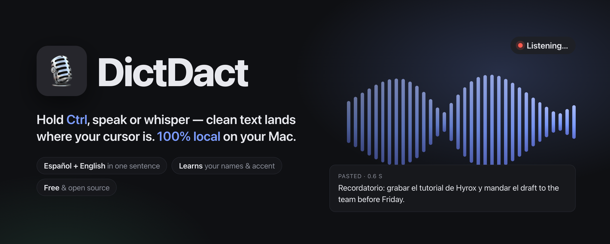

# DictDact 🎙 — Guía de instalación (español)

<p align="center"></p>

Guía visual con capturas: [abrahamolvera.ai/dictdact](https://abrahamolvera.ai/dictdact/)

Dictado local y privado para macOS, al estilo *push-to-talk*: mantén presionada la tecla
**Ctrl**, habla (o susurra) en **español, inglés o ambos en la misma frase**, suelta la tecla,
y el texto limpio y estructurado se pega donde esté tu cursor. Todo corre **100% en tu Mac**
(Apple silicon, MLX) — tu voz nunca sale de tu computadora.

## Requisitos

- Mac con **Apple silicon** (M1 o más nuevo). Los Mac Intel no están soportados, y no existe
  versión para Windows: el motor de voz corre sobre MLX, el framework de Apple silicon.
- **macOS 14 Sonoma** o más reciente.
- **16 GB de memoria** recomendados (con 8 GB funciona usando un modelo Whisper más chico y
  formato `rules`).
- ~8 GB de disco libres.
- Internet **solo la primera vez**: los modelos de voz (≈3.6 GB) se descargan en el primer
  arranque y después todo funciona sin conexión.

## Opción A — Instalación fácil (sin terminal)

1. Descarga el `DictDact-x.y.z.dmg` más reciente desde la página de
   [**Releases**](https://github.com/abrahamolverad/dictdact/releases/latest) (gratis),
   ábrelo y arrastra **DictDact** a **Aplicaciones**.
2. Abre DictDact. Si macOS dice que *"no se puede verificar el desarrollador"*, ve a
   **Ajustes del Sistema → Privacidad y seguridad**, baja hasta el final y toca **Abrir de todos
   modos** (solo hace falta una vez).
3. La ventana de **Bienvenida** descarga los modelos con una barra de progreso y te guía por los
   dos permisos:
   - **Micrófono** — acepta cuando lo pida.
   - **Accesibilidad** — activa *DictDact* en la lista (esto le permite ver la tecla Ctrl y pegar
     el texto por ti).
   La ventana se cierra sola cuando todo está listo.
4. Mantén **Ctrl** y habla. DictDact también se registra para arrancar al iniciar sesión y
   volver solo si algo lo cierra (menú 🎙 → *Start at login & restart if it crashes* para
   desactivarlo).

## Opción B — Instalación para developers (con terminal)

```bash
git clone https://github.com/abrahamolverad/dictdact && cd dictdact && ./scripts/install.sh
```

El script crea el entorno de Python, descarga los modelos, construye `~/Applications/DictDact.app`
alrededor del entorno (así los permisos de macOS quedan a nombre de "DictDact") y enlaza el comando
`dictdact` en `/opt/homebrew/bin`. Los cambios de código aplican en el siguiente arranque — nunca
reconstruyas el bundle salvo que sea indispensable (macOS olvida los permisos al cambiar la firma).

## Permisos (una sola vez)

| Permiso | Para qué | Dónde |
|---|---|---|
| **Accesibilidad** | presionar ⌘V en la app activa (y frontear la app bajo el mouse) | Ajustes del Sistema → Privacidad y seguridad → Accesibilidad → activar **DictDact** |
| **Monitoreo de entrada** | ver la tecla Ctrl globalmente — en macOS 26 Accesibilidad ya no lo cubre | Ajustes del Sistema → Privacidad y seguridad → Monitoreo de entrada → activar **DictDact** (botón **+** → `~/Applications/DictDact.app` si no aparece) |
| **Micrófono** | obvio 🙂 | macOS lo pide en el primer dictado |

DictDact detecta cuando el permiso llega y re-arma el atajo solo; la línea de estado del menú 🎙
dice qué falta.

## Cómo se usa

| Gesto | Resultado |
|---|---|
| **Mantener Ctrl** (≥ 0.18 s), hablar, soltar | graba → transcribe → estructura → pega en el cursor |
| **Tap-tap Ctrl** | modo manos libres (🔒); un **tap** más para terminar |
| **Ctrl + otra tecla/click** | se trata como atajo normal; la grabación se descarta en silencio |
| **Ctrl+Alt+V** | vuelve a pegar el último dictado donde está el cursor del teclado — ignora "Paste where the mouse points"; es la tecla de rescate cuando el texto cayó en el lugar equivocado. Se puede cambiar con `retrieve_combo` en el config (por ejemplo `"ctrl+alt+s"`) |
| **Ctrl+Alt+H** | abre la ventana de DictDact (estado, historial, diccionario, micrófono, ajustes, Guía) |

## Guía rápida

**¿El texto no cayó donde querías? → Ctrl+Alt+V.** Vuelve a pegar el último dictado exactamente
donde está el cursor del teclado (no donde esté el mouse), así que es la tecla de rescate cuando
el texto se perdió o cayó en la app equivocada — funciona incluso si ya se pegó mal o no se pegó
en ningún lado. Si necesitas un dictado más viejo, **Ctrl+Alt+H** abre la ventana y la pestaña
**Dictations** te deja copiar o pegar cualquier take anterior, y arriba muestra la gráfica de **palabras por día** (14 d / 30 d / todo).

- **Cómo dictar:** mantén Ctrl, habla, suelta — se pega solo donde tienes el cursor.
- **Idioma fijo o automático:** por default detecta español/inglés en cada toma (y permite
  mezclar en la misma frase); si prefieres fijarlo, 🎙 → **Language** → *Español* o *English*
  (o por terminal: `dictdact config --language es`).
- **Diccionario:** enséñale tus términos propios — por ejemplo, que "acne labs" se escriba
  **Acme Labs**. Se edita en la pestaña **Dictionary** (🎙 → *Vocabulary…*) o por terminal:
  `dictdact vocab add "Acme Labs" --spoken "acne labs, ack me labs"`. Agrega el nombre una sola
  vez (con la casilla “sound-alike” marcada; en la terminal, `--fuzzy`) y DictDact atrapa solo todas las formas en que lo oye después ("Hirox", "Hierox" →
  "Hyrox"). La pestaña **Dictionary** también te sugiere nombres sacados de tus propios
  dictados (las variantes que ya dijiste, agrupadas por sonido) para que los agregues con un
  clic. Y si un dictado salió mal, corrígelo con **Fix → Save & learn**: guarda tu versión y
  aprende "oí X → escribe Y" para la próxima vez. Al empezar a grabar, DictDact también se fija
  en los nombres que están visibles en la ventana donde vas a dictar, para escribirlos bien
  aunque no estén en tu diccionario.
- **Correcciones al hablar:** si te equivocas, di "no, mejor…", "digo…" o "perdón" y solo se
  queda la versión corregida; "borra eso" / "tacha eso" borra la frase anterior.

Iconos del menú: 🎙 listo · 🔴 escuchando · 🔒 manos libres · ⏳ transcribiendo · 💤 cargando · ⚠️ error.

**Tip:** si sueles mirar una ventana mientras el teclado tiene el foco en otra, activa
🎙 → *Paste where the mouse points* y el texto se pega en la app que estás apuntando con el
mouse (sin clicks sintéticos; mueve el foco del teclado a esa app). Sobre el escritorio, la
barra de menús o la propia ventana de DictDact se comporta como siempre. Los campos de
contraseña nativos se respetan (el texto queda en el portapapeles); los de páginas web no
siempre se pueden detectar.

**Estilos de resultado:** por default el dictado es **literal** (estilo `clean`, con
verificación: si el modelo resume, traduce o "responde" lo que dictaste por su cuenta, se
descarta y recibes tus palabras con limpieza determinista). Cuando quieras transformar de
verdad: 🎙 → *Result style* → mejorar, traducir a inglés/español o resumir.

## Banco de voz (clonación de voz)

Cada dictado tuyo ya es voz limpia, natural, de un solo hablante — justo lo que necesita un clon de
voz para entrenar, y que nadie se sienta a grabar aparte. Actívalo con el menú 🎙 → **Voice bank**
o `dictdact voicebank on` y, además de transcribirse, cada toma se guarda **tal cual la capturó el
micrófono** — su frecuencia de muestreo original, FLAC de 24 bits, sin recortar ni normalizar,
nunca la copia a 16 kHz que usa el modelo de voz — en
`~/.local/share/dictdact/voice-bank/<fecha>/<id>.flac`, calificada e indexada por idioma. Solo se
guarda español e inglés, solo del micrófono que elegiste (una toma con el micrófono de respaldo, o
de menos de 2 s, se descarta), y la recolección de cada idioma se detiene sola al llegar a 180
minutos utilizables (`voice_bank_target_min`) — de sobra para un Professional Voice Clone de
ElevenLabs, que pide 30 minutos como mínimo y recomienda 2–3 horas. Una notificación avisa al
llegar a 30/120/180 minutos utilizables por idioma, y una vez al día si la mayoría de lo que está
entrando es demasiado ruidoso para usarse.

```bash
dictdact voicebank status                  # minutos por idioma + un veredicto (en inglés) sobre tu micrófono y tu cuarto
dictdact voicebank on / off
dictdact voicebank export --lang es        # las tomas más limpias en MP3 (192 kbps) + report.json
dictdact voicebank reference --lang es     # un clip de referencia de ~20 s para clonación zero-shot
dictdact voicebank say "texto" --lang es   # habla el texto con el clon local (Chatterbox, sin nube, sin costo)
```

**Subirlo a ElevenLabs:**

1. `dictdact voicebank export --lang es` (o `en`) — escribe las tomas más limpias como MP3s en
   `~/.local/share/dictdact/voice-bank/exports/<idioma>-<hora>/`.
2. ElevenLabs → **Voices → Add Voice → Professional Voice Clone** (mínimo 30 minutos; 2–3 horas
   entrena un clon notablemente mejor) → sube todos los archivos de esa carpeta.
3. Completa la verificación de voz de ElevenLabs (leer en voz alta la frase que te muestran) — es
   obligatoria antes de poder usar el clon.

**Privacidad:** todo lo que dictas con Voice bank activo se guarda como audio, solo en tu Mac —
nada sale de ella a menos que tú mismo subas el resultado de `export`. Apágalo cuando quieras
(`dictdact voicebank off` o el mismo menú); borra `~/.local/share/dictdact/voice-bank` para borrar
todo lo guardado.

## Si algo no funciona

- **No pega el texto** → revisa Accesibilidad (arriba); el texto siempre queda también en el
  historial (Ctrl+Alt+H) y en el portapapeles.
- **No reconoce nada** → `dictdact doctor` muestra permisos, micrófono y modelos en un solo
  reporte.
- **Va lento con la RAM llena** → DictDact mantiene sus modelos "calientes" y fijados en memoria
  (`keep_warm_s`, `wire_memory` en `~/.config/dictdact/config.json`); si un dictado tardó, el log
  `~/.local/share/dictdact/dictdact.log` dice exactamente por qué: busca la línea `timings:` y los
  avisos `models were cold or the GPU busy`.
- **Registro completo** → `~/.local/share/dictdact/dictdact.log`.

## Privacidad

Sin cuentas, sin nube, sin telemetría. Audio, transcripciones e historial viven solo en
`~/.local/share/dictdact/` de tu Mac. El banco de voz (arriba) está **apagado por default** y,
aun activo, no sube nada por su cuenta — solo tú decides subir un `export`.
