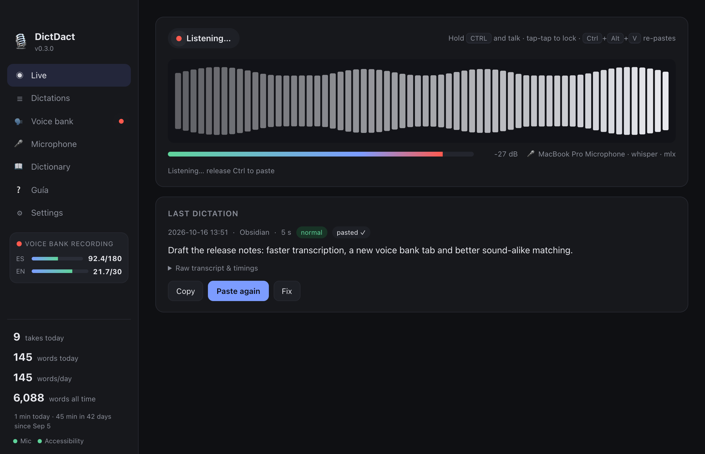
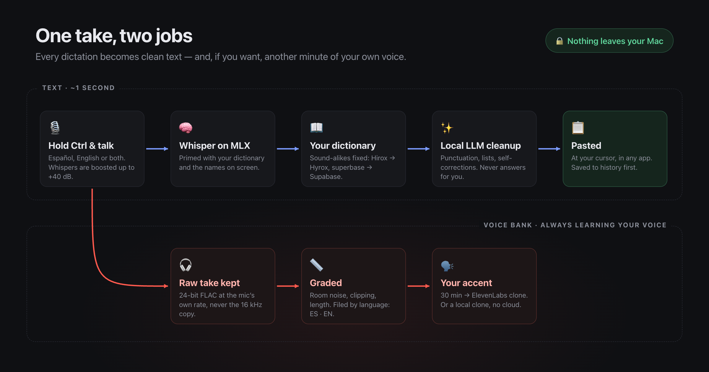
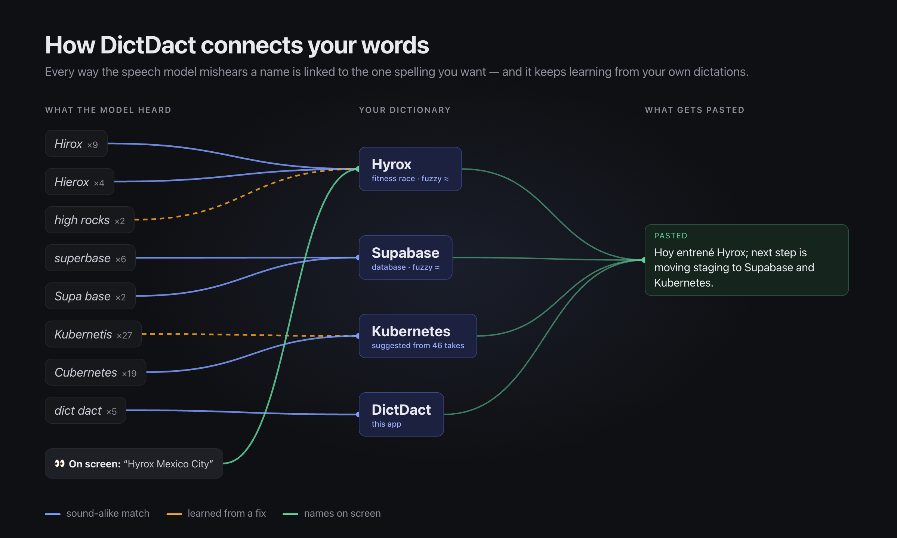
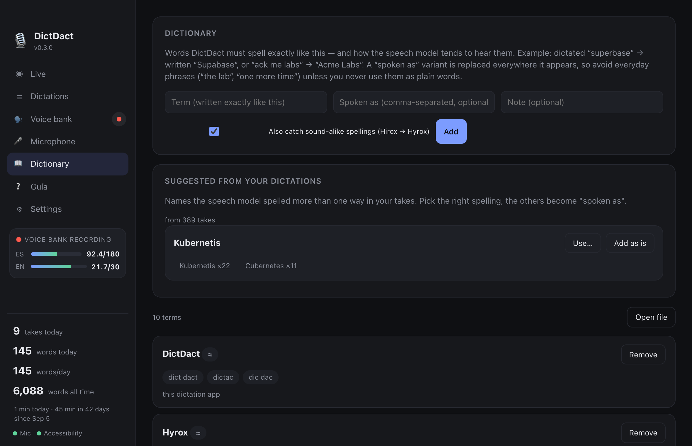
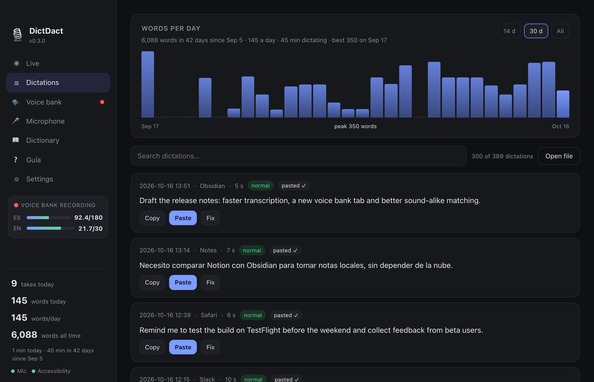
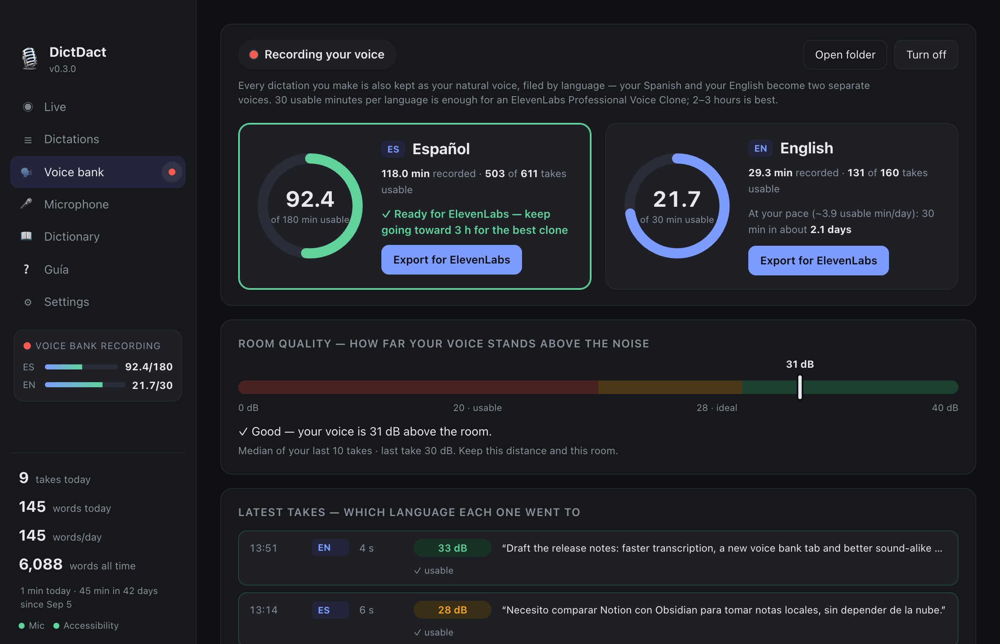

<p align="center"></p>

<p align="center">
  <a href="https://github.com/abrahamolverad/dictdact/releases/latest"><b>⬇︎ Download for Mac (free)</b></a> ·
  <a href="https://abrahamolvera.ai/dictdact/">Guía de descarga en español</a> ·
  <a href="INSTALL.es.md">Instalación en español</a>
</p>

<p align="center">
  
  
  
  
</p>

# DictDact 🎙

Local, private push-to-talk dictation for macOS — an assistant that takes notes for you and runs
entirely on your Mac (Apple silicon, MLX). Hold **Ctrl**, talk or *whisper* in **Spanish, English or
both in the same sentence**, release, and clean structured text is pasted wherever your cursor is.
No account, no subscription, no cloud: your voice never leaves your computer.

<p align="center"></p>

## What it does

- **Speech → text:** Whisper large-v3-turbo (default) or NVIDIA Parakeet TDT v3, both via MLX.
  Auto language detection, bilingual prompt so Spanglish stays Spanglish (never translated).
- **Whisper-friendly:** every recording is analysed (level, noise floor, dynamics), whispered/quiet
  speech is detected and boosted up to +40 dB, silence is trimmed, known Whisper "hallucination"
  phrases are dropped, and decoder loops are collapsed before anything is pasted.
- **Structured text:** a local LLM (Qwen3-4B on MLX, or any Ollama model) fixes punctuation/accents,
  removes fillers (*um, este, o sea…*), applies self-corrections, turns enumerations into lists and
  honours spoken commands (*nueva línea, punto y aparte, new paragraph…*). It is guarded so it can
  never *answer* what you dictated; if it tries, the raw text is used instead.
- **Learns your words:** a dictionary of the names you use, sound-alike matching, suggestions mined
  from your own dictations, and fixes that teach it on the spot.
- **Banks your voice:** optionally keeps every take as studio-quality audio, graded and filed by
  language, so your everyday dictation becomes the training set for a clone of *your* voice, with
  *your* accent and pronunciation — in Spanish and in English separately.
- **Never lose a dictation:** every take is saved as its own block in
  `~/.local/share/dictdact/history.jsonl` *before* it is pasted. **Ctrl+Alt+V** re-pastes the last
  block; the menu bar lists recent blocks to re-paste any of them.

<p align="center"></p>

## How it connects your words

Speech models mishear names — *Hirox*, *Hierox*, *high rocks*. DictDact links every one of those
spellings to the single spelling you want, from three sources: your dictionary (with sound-alike
matching), the fixes you make in the window, and the names visible on screen while you talk.

<p align="center"></p>

It also reads your history and **suggests** names it has seen spelled more than one way, with the
evidence (how many takes carried each spelling):

<p align="center"></p>

## See how much you say

Every dictation is searchable, with words per day, time spoken and per-take details (mode, app,
timings), and one click to copy, paste again or fix.

<p align="center"></p>

## Your voice, always learning

Turn on **Voice bank** and each dictation is also kept raw — the mic's own sample rate, 24-bit FLAC —
graded for room noise and filed by language. Progress rings show how close each language is to a
voice clone, a gauge tells you how far your voice stands above the room, and every take shows which
language it went to.

<p align="center"></p>

> Screenshots use invented demo data — no real dictations are shown.

## Download (everyone — no terminal needed)

**Requirements:** a Mac with Apple silicon (M1 or newer), macOS 14 Sonoma or later, 16 GB of memory
recommended (8 GB works with a smaller Whisper model + `rules` formatting), ~8 GB of free disk, and an
internet connection once — the speech models (≈3.6 GB) are downloaded on first launch and then
everything runs offline. Intel Macs are not supported (the models run on Apple's MLX).

1. Download the latest `DictDact-x.y.z.dmg` from the
   [**Releases** page](https://github.com/abrahamolverad/dictdact/releases/latest), open it and drag
   **DictDact** to **Applications**.
2. Open DictDact. The free build is not notarized by Apple yet, so macOS says it *"could not verify
   the developer"*: go to **System Settings → Privacy & Security**, scroll down and click
   **Open Anyway** (only once).
3. The **Welcome** window downloads the models with a progress bar and walks you through the
   permissions: **Microphone** (allow when asked), **Accessibility** and, on macOS 26, **Input
   Monitoring** (turn on *DictDact* in each list — this is what lets it see the Ctrl key and paste).
   It closes itself when everything is ready.
4. Hold **Ctrl** and talk. DictDact also registers itself to start at login and to come back by itself
   if it ever crashes (🎙 menu → *Start at login & restart if it crashes* to turn that off).

## Install (developers)

```bash
git clone https://github.com/abrahamolverad/dictdact && cd dictdact && ./scripts/install.sh
```

That creates the venv, downloads the models, builds `~/Applications/DictDact.app` around the venv (so
macOS permission grants are attributed to "DictDact") and links a `dictdact` command into `/opt/homebrew/bin`.
Code changes apply on the next launch — never rebuild the bundle unless you must (see below).

### Building the downloadable app

```bash
scripts/build-release.sh            # → dist/DictDact-<version>.dmg  (self-contained: bundled CPython + wheels)
```

The bundle has no Homebrew or home-directory dependencies (`scripts/check-relocatable.py` enforces it) and
downloads the models on first launch. Without a certificate it is ad-hoc signed, so other Macs show the
"Open Anyway" hurdle. For a frictionless install, sign and notarize:

1. In Xcode → Settings → Accounts → *Manage Certificates…* → **+** → *Developer ID Application*.
2. `xcrun notarytool store-credentials dictdact-notary --apple-id you@example.com --team-id TEAMID --password <app-specific password>`
3. `SIGN_IDENTITY="Developer ID Application: Your Name (TEAMID)" NOTARY_PROFILE=dictdact-notary scripts/build-release.sh`

GitHub Actions does the same on every `v*` tag (`.github/workflows/release.yml`) and attaches the DMG to a
Release; add the secrets `MACOS_CERT_P12` (base64 .p12), `MACOS_CERT_PASSWORD`, `SIGN_IDENTITY`, `APPLE_ID`,
`APPLE_TEAM_ID`, `APPLE_APP_PASSWORD` to get notarized builds.

### One-time permissions

Launch the app once (`open ~/Applications/DictDact.app`). macOS will ask for:

| Permission | Why | Where |
|---|---|---|
| **Accessibility** | to press ⌘V in the active app (and front the app under the mouse) | System Settings → Privacy & Security → Accessibility → enable **DictDact** |
| **Input Monitoring** | to see the Ctrl key globally — on macOS 26 Accessibility no longer covers this | System Settings → Privacy & Security → Input Monitoring → enable **DictDact** (use **+** → `~/Applications/DictDact.app` if the row is missing) |
| **Microphone** | obvious | prompted on first dictation |

DictDact notices when the grant lands and re-arms the hotkey by itself. The menu bar status line says what
is still missing.

> Rebuilding `DictDact.app` (`FORCE=1 scripts/make-app.sh`) changes its ad-hoc signature, and macOS then
> forgets all grants — and may keep a stale "DictDact" row that looks enabled but isn't. If that happens:
> `tccutil reset Accessibility com.abrahamolvera.dictdact`, relaunch, and turn it on again.

## Use

| Gesture | Result |
|---|---|
| **Hold Ctrl** (≥ 0.18 s), speak, release | records → transcribes → structures → pastes at the cursor |
| **Tap-tap Ctrl** | hands-free lock (🔒 in the menu bar); **tap Ctrl** again to finish |
| **Ctrl + any key / click** | treated as a normal shortcut, recording is discarded silently |
| **Ctrl+Alt+V** | re-paste the last dictation at the keyboard cursor — ignores "Paste where the mouse points"; the recovery key when a dictation lands somewhere wrong. Re-bind it with `retrieve_combo` (e.g. `"ctrl+alt+s"`) |
| **Ctrl+Alt+H** | open the **DictDact window**: Live (state + waveform + level), Dictations (words-per-day chart, search, Copy / Paste / Raw), Dictionary (custom vocabulary), Microphone (pick + test meter), Settings, Guía (Spanish quick guide) |
| Menu bar 🎙 | choose microphone, engine, formatter, language; edit vocabulary; recent dictations; copy last; history |

Icons: 🎙 ready · 🔴 listening · 🔒 locked · ⏳ transcribing · 💤 loading · ⚠️ error.
Sounds: a *tink* once the hold is recognised, *pop* when you release, *blow* when text is pasted.

Typical latency on an M-series Max: ~0.3 s transcription + 0.3–1.5 s structuring.

## Microphone

Menu bar → **Microphone**, or:

```bash
dictdact devices
dictdact config --mic "USB Studio Mic"
```

Devices are matched by name, so USB re-enumeration doesn't matter.

## Whispering

Whisper large-v3 handles whispered speech well as long as the signal is clean. DictDact boosts quiet
takes automatically (`max_gain_db`, default 40). For best results whisper close to the mic and away from
fans — at very low SNR (< 15 dB) any model starts guessing. The history records each take's `mode`
(`whisper` / `quiet` / `normal`) so you can see what the analyser thought.

## Language

Menu bar 🎙 → **Language** (also in the window's **Settings** tab, and `dictdact config --language
es|en|auto`):

- **Auto (Spanish + English)** — detected once per take; Whisper is primed with a prompt in the
  detected language (plus one code-switched clause), so mixing languages mid-sentence still comes
  out as spoken, never translated.
- **Español** / **English** — locks Whisper's language token and prompt to that language, and
  tells the formatter to write everything in it while keeping proper nouns and product names as
  spoken.

If you mostly code-switch and want raw speed, try Parakeet v3 (no language token at all):
`dictdact config --engine parakeet`.

## Dictionary (custom vocabulary)

`~/.config/dictdact/vocabulary.json` — created with built-in defaults on first run:

```json
{"terms": [{"term": "Acme Labs", "spoken": ["acne labs", "ack me labs"], "note": "the company"}]}
```

Edit it from the window's **Dictionary** tab (🎙 → **Vocabulary…**), from the file directly, or the CLI:

```bash
dictdact vocab list
dictdact vocab add "Acme Labs" --spoken "acne labs, ack me labs" --note "the company"
dictdact vocab remove "Acme Labs"
```

Each term is (a) put in Whisper's prompt so it's spelled right, (b) given to the LLM as a glossary,
and (c) applied as a deterministic replacement on the raw transcript and on the formatted text, so
it's right even when both models miss it. Spelled-out acronyms work too ("M L X" / "M-L-X"
→ MLX), and a term with stylized casing (MLX, WHOOP, TestFlight, acme.io) fixes its own
casing.

### Sound-alike matching

A term added once catches every spelling the speech model invents for it, automatically: with only
`Hyrox` in the dictionary, "Hirox", "Hierox", "Hyrux" all become Hyrox; `Supabase` catches
"Superbase"; `ManyChat` catches "Manichat"; `Wispr Flow` catches "Whisper Flow". It works on
capitalized words inside a sentence (the way Whisper writes names it does not know) and on all-caps
words; lowercase ordinary words are never touched ("codecs", "many chat", "super base" stay), a
capitalized word at the start of a sentence is not touched either, and words you also use in
lowercase in your own dictations are protected (learned from your history). Each hit is logged as
`fuzzy: Hirox → Hyrox`. Turn it off per term with `"fuzzy": false` in the file. Spoken variants
listed by hand (`spoken`) still apply first and are still useful for multi-word mishearings ("acne
labs" → Acme Labs). Sound-alike matching is opt-in per term: in the window the "also catch sound-alike spellings" box on the add form is ticked by default; from the CLI pass `--fuzzy` (`dictdact vocab add "Hyrox" --fuzzy`) and `--no-fuzzy` switches it off again. Seeds that are people, characters or acronyms (MLX, Codex, Claude…) ship with it off; product names ship with it on. A spelling learned from a fix is kept in the term's `learned` list and applied only where a name can stand (a capitalized word inside a sentence), never to an ordinary lowercase word.

### Suggestions from your dictations

The **Dictionary** tab shows "Suggested from your dictations": names your takes spelled more than
one way, clustered by sound, with counts (e.g. Hyrox ×6, Hirox ×3, Hierox ×2). "Use…" prefills the
add form so you can fix the spelling; "Add as is" adds directly. CLI: `dictdact vocab suggest`
prints the same clusters with evidence. Clusters that already sound like a term you already have
are not suggested.

### Learn from a fix

In the window (Live tab, last dictation, and Dictations), **Fix** lets you edit the text of a
dictation; **Save & learn** keeps your version, copies it to the clipboard, and adds every name you
respelled ("Hirox" → "Hyrox") to the dictionary on the spot (toast "Learned: Hirox → Hyrox"),
logged to `~/.local/share/dictdact/learned.jsonl`. Content changes ("John" → "Daniel") and grammar
edits teach nothing. API: `POST /api/fix {id, text}`.

### Names from the active window

At the start of a dictation DictDact reads the visible text of the app you are dictating into
(through Accessibility, bounded to 300 ms, on its own thread — a take never waits for it) and puts
the capitalized names it finds into Whisper's prompt for that take only, so a name that's on screen
is spelled right even if it isn't in the dictionary. Log line: `context: 3 terms from Claude`. Setting: Settings → "Use the names visible in the active window"
(`context_terms`, on by default; `dictdact config --set context_terms=false`). Nothing leaves the
Mac.

Not done: fine-tuning Whisper on your own voice — there's no local training path for mlx-whisper.

## Voice bank (voice cloning)

Every dictation is already clean, natural, single-speaker speech — exactly the raw material a
voice clone trains on, and that nobody sits down to record on purpose. Turn on **Voice bank** (🎙
menu, or `dictdact voicebank on`) and each take is *also* saved raw — the mic's own sample rate,
24-bit FLAC, untrimmed, un-normalized, never the 16 kHz copy the speech model sees — under
`~/.local/share/dictdact/voice-bank/<date>/<id>.flac`, graded, and indexed by language. Only
Spanish and English are kept, only from the microphone you actually selected (a fallback mic, or a
take under 2 s, is skipped), and collection for a language stops by itself once it holds 180
usable minutes (`voice_bank_target_min`) — well past what an ElevenLabs Professional Voice Clone
needs (30 minutes minimum, 2–3 hours recommended). A notification marks 30/120/180 usable minutes
per language, and warns once a day if most of what's coming in is too noisy to use.

```bash
dictdact voicebank status                  # minutes collected per language + a plain-language verdict on your mic/room
dictdact voicebank on / off
dictdact voicebank export --lang es        # the cleanest takes as chunked MP3s (192 kbps) + report.json
dictdact voicebank reference --lang es     # a ~20 s reference clip for zero-shot cloning
dictdact voicebank say "texto" --lang es   # speak with a local clone (set DICTDACT_CLONE_PYTHON + DICTDACT_CLONE_SCRIPT)
```

### Uploading to ElevenLabs

1. `dictdact voicebank export --lang es` (or `en`) — writes the cleanest takes as chunked MP3s into
   `~/.local/share/dictdact/voice-bank/exports/<lang>-<time>/`.
2. ElevenLabs → **Voices → Add Voice → Professional Voice Clone** (30 minutes minimum, 2–3 hours
   trains a noticeably better clone) → upload every file from that export folder.
3. Finish ElevenLabs' voice-verification step (read the on-screen sentence aloud) — required before
   the cloned voice can be used.

### Privacy

Everything you dictate while Voice bank is on is kept as audio, on your Mac only — nothing leaves
it unless you run `export` and choose to upload the result yourself. Turn collection off any time
(`dictdact voicebank off` or the menu item); delete `~/.local/share/dictdact/voice-bank` to erase
everything that was kept.

## Text structuring backends

| `formatter` | What | Speed |
|---|---|---|
| `mlx` (default) | Qwen3-4B-Instruct on MLX, system prompt KV-cached | 0.2–1.5 s |
| `ollama` | any Ollama model (`ollama_model`, default `gemma4:12b`) — slightly better Spanish | 1–15 s |
| `rules` | deterministic cleanup only (fillers, capitalisation, spoken commands) | instant |
| `off` | raw transcript (+ spoken line/paragraph commands) | instant |

### Result styles

Dictation is verbatim by default. The `clean` style asks the LLM only to tidy your words — and
*checks* that it did only that: if the model summarizes, translates, or performs a task you
merely dictated (long takes tempt small models), the output is rejected and the deterministic
cleanup is used instead. Choose a transformation on purpose with 🎙 → **Result style** or the dashboard's Settings tab
(both apply immediately; `dictdact config --set formatter_style=…` only writes the file for the
NEXT launch and is overwritten if the running app saves): `improve` (rewrite for clarity, same
language mix), `translate_en` / `translate_es`, `summary`. When an output is rejected or a style
fails, the menu-bar status says so and history tags the take `mlx→rules`.

### Self-corrections

Saying "no, mejor…", "quiero decir…", "digo…", "mejor dicho", "o sea, no", "perdón", "I mean…",
"actually…", "no wait", "scratch that" or "let me rephrase" keeps only the corrected version;
"borra eso" / "tacha eso" / "scratch that" delete the phrase spoken right before them. "etcétera"
is written "etc."

## Config

`~/.config/dictdact/config.json` (`dictdact config` prints it; `dictdact config --set key=value` edits it).

| key | default | meaning |
|---|---|---|
| `microphone` | `null` (system default) | device name or substring |
| `hotkey` | `ctrl` | `ctrl`, `ctrl_l`, `ctrl_r`, `alt_r`, `cmd_r`, `shift_r`… |
| `retrieve_combo` | `ctrl+alt+v` | the re-paste shortcut. Its own key on purpose: ⌘V pastes whatever the clipboard holds, this always pastes your **last dictation**. At least one modifier (`ctrl`/`alt`/`shift`/`cmd`) plus one letter; a spec that cannot work is refused and the menu keeps showing the one that is really live |
| `hold_threshold_ms` | `180` | shorter = a tap |
| `double_tap_lock` | `true` | tap-tap for hands-free |
| `engine` | `whisper` | `whisper` or `parakeet` |
| `language` | `null` | `null` = auto, `es`, `en` |
| `max_gain_db` | `40` | max boost for whispers |
| `formatter` | `mlx` | see above |
| `formatter_style` | `clean` | `clean` = verbatim, **enforced** (a summary/translation/answer from the model is rejected and the deterministic cleanup used — you always get your own words); `improve` / `translate_en` / `translate_es` / `summary` = explicit transformations (🎙 menu → **Result style**) |
| `paste` | `true` | paste into the active app (else copy to clipboard) |
| `paste_target` | `focus` | `focus` = the app with keyboard focus; `mouse` = the app under the pointer is fronted first (🎙 menu → *Paste where the mouse points*). App-level and click-free: the pointed-at app's own focused window/field receives the text (keyboard focus moves there, +~0.3–1 s). Over DictDact's own window, the desktop or the menu bar — and whenever fronting fails — it behaves exactly like `focus`. Native secure (password) fields are refused and the text stays in the clipboard; web password boxes (Chrome/Electron) can't always be detected. Same-app second windows and Stage Manager strips are not resolved |
| `restore_clipboard` | `false` | put your previous clipboard back after pasting. Off by default: nothing can confirm a ⌘V actually landed in the app you meant, and restoring took the dictation away from the one retry that always works — pressing ⌘V yourself. Left off, the last take is in the clipboard until the next one |
| `formatter_timeout_s` | `12` | wall-clock ceiling on one take's LLM pass. Past it the pass is abandoned and the deterministic cleanup delivers your words instead. It only bites when another app is saturating the GPU — a warm pass on a free machine runs at ~400–700 chars/s |
| `keep_recordings` | `false` | also save the WAV of every take |
| `max_seconds` | `600` | safety cap per take |
| `keep_warm_s` | `45` | touch the models every N s while idle so macOS keeps them resident (`0` = off) |
| `wire_memory` | `true` | wire the MLX weights (they can never be paged out to swap) |
| `context_terms` | `true` | read capitalized names from the active window's visible text into Whisper's prompt for that take (Settings → "Use the names visible in the active window") |
| `voice_bank` | `false` | also keep every take raw, at the mic's own rate, for a voice clone (🎙 menu → *Voice bank*; see [Voice bank](#voice-bank-voice-cloning)) |
| `voice_bank_target_min` | `180` | per language, collection stops once this many *usable* minutes are banked |

## Staying fast under heavy RAM load

When another app eats tens of GB (video generation, big builds…), macOS pages idle model weights
out to compressed memory/swap — and a dictation that normally takes ~1 s suddenly takes 15+ s of
page-in *after* you release the key. DictDact defends itself three ways:

1. **Wired memory** (`wire_memory`): the Whisper + Qwen weights are wired via MLX, so the pager
   can never evict them (~4–5 GB held resident; on small-memory Macs the limit is capped to what
   the GPU recommends).
2. **Keep-warm heartbeat** (`keep_warm_s`): while idle, a tiny inference every 45 s (~0.2–0.5 s
   when warm) keeps every weight page on the active list.
3. **Pre-warm on hold**: if the models have been idle, they are re-touched the moment your Ctrl
   hold is confirmed as a dictation (~0.2 s in), so any remaining page-in overlaps with your
   speech instead of delaying the paste. Re-pasting (**Ctrl+Alt+V**) runs on its own fast lane
   and never waits behind a touch or a transcription.

If a take was still slow, the log (`~/.local/share/dictdact/dictdact.log`) says why:
`models were cold or the GPU busy — hotkey touch took 3.2s (pressure from a neighbouring app)`
plus a per-take `timings:` line.

## CLI

```bash
dictdact                 # menu-bar app (same as the .app)
dictdact run --headless  # no menu bar, prints to the terminal
dictdact transcribe file.wav [--engine parakeet] [--formatter rules]
dictdact history -n 20
dictdact config --language es|en|auto   # lock the language, or auto-detect
dictdact vocab list                     # show custom vocabulary
dictdact vocab add "TERM" --spoken "..." --note "..."
dictdact vocab remove "TERM"
dictdact vocab suggest                  # names spelled more than one way, clustered by sound
dictdact voicebank status               # voice-bank collection: minutes per language, mic verdict
dictdact voicebank export --lang es     # cleanest takes → upload-ready files for ElevenLabs
dictdact open            # show the window (= Ctrl+Alt+H)
dictdact ui              # open the same dashboard in your browser
dictdact quit            # stop cleanly (no auto-restart); relaunch from ~/Applications
dictdact doctor
```

## Layout

```
dictdact/audio.py      capture, whisper detection, normalisation, trimming
dictdact/transcribe.py Whisper / Parakeet engines, hallucination filter
dictdact/format.py     LLM + rules structuring, answer guard, break restoration
dictdact/vocab.py      custom vocabulary: prompt tail, LLM glossary, deterministic replacements
dictdact/learn.py      suggestions from history, learn from fixes
dictdact/context.py    names visible in the active window → Whisper prompt
dictdact/voicebank.py   raw takes graded and banked for a voice clone; export/reference/say
dictdact/hotkey.py     hold / tap-tap / combo / re-paste state machine
dictdact/pipeline.py   worker thread: record → transcribe → format → paste → history
dictdact/app.py        rumps menu bar + headless runner
scripts/make-app.sh   builds DictDact.app around the venv (stable permission identity)
```

Logs: `~/.local/share/dictdact/dictdact.log`.
